---

## 💡 Sobre mim

Sou estudante de Engenharia de Software e apaixonado por transformar ideias em código. Meu foco atual é **cibersegurança**: gosto de entender como os sistemas funcionam por dentro para poder protegê-los.

Aprendo na prática, criando projetos, estudando constantemente e buscando evoluir ao lado de profissionais mais experientes.

---

## 🛠️ Tecnologias e conhecimentos

- 🌐 Desenvolvimento web com **HTML, CSS e JavaScript**
- 🐍 Programação em **Python**
- ⚙️ Programação em **C**
- 📊 Análise de dados com **Power BI**
- 🗄️ Modelagem conceitual de **banco de dados**
- 🖥️ Fundamentos de TI: **hardware e software**
- 🤖 Noções de IA generativa com **Microsoft Foundry**

---

## 📂 Projetos em destaque

### 🔢 [cifra-fibonacci](https://github.com/joe1801-blip/cifra-fibonacci)
Cifra desenvolvida em **C** que utiliza a sequência de Fibonacci, progressão aritmética (P.A.) e deslocamento (shift) escolhido pelo usuário.

### 🛡️ [SecureLog-Analyzer](https://github.com/joe1801-blip/SecureLog-Analyzer)
Projeto voltado à **análise de logs de segurança**, aliando programação e cibersegurança.

---

## 🏟️ Projetos em equipe: Clube CSEU

### ⚽ [Clube Social Esportivo União (CSEU)](https://github.com/Gustavogomessk/black_white)
Site institucional de um clube esportivo e social, desenvolvido em equipe (**Equipe Black White**) na disciplina de Desenvolvimento Front-End para Web.

- 🌐 **Site publicado:** [clubecseu.vercel.app](https://clubecseu.vercel.app)
- 👨‍💻 **Minha função:** desenvolvimento e codificação das páginas do projeto
- 🧱 **Tecnologias:** HTML5 semântico, CSS (Flexbox), formulários, tabelas e navegação entre páginas
- 📄 **Páginas:** início, clube, atletas, modalidades, turmas, reservas, orçamento, eventos, loja, unidades, contato e política de privacidade

### 🗂️ [Projeto ERP do Clube (evidências)](https://github.com/Gustavogomessk/projeto_erp_clube/tree/main/evidencias)
Projeto de ERP para o clube, com as evidências do desenvolvimento reunidas no repositório da equipe.

---

## 📜 Cursos e certificações

- **Otimizar o desempenho do modelo de IA generativa com o Microsoft Foundry**, Microsoft Learn (2026)
- **Linguagem de Programação Python: Básico**, Fundação Bradesco (18h, 2026)
- **Fundamentos de TI: Hardware e Software**, Fundação Bradesco (7h, 2026)
- **Introdução à Análise de Dados: Microsoft Power BI**, Fundação Bradesco (5h, 2026)

---

## 🎯 Meus objetivos

- Construir uma carreira sólida em **tecnologia e cibersegurança**
- Aprender com profissionais mais experientes
- Desenvolver projetos que unam código e segurança

---

## 📫 Vamos conversar?

---

⭐ *Sempre aprendendo, sempre evoluindo.*

